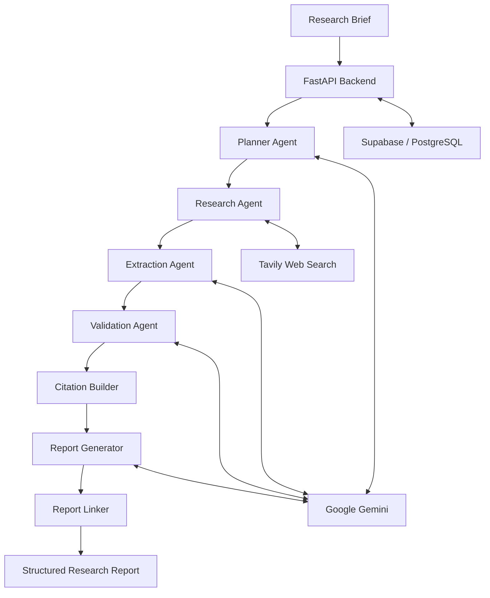

# AI Market Research & Strategy Engine

An AI-powered market research application that transforms a research brief into a structured report supported by web sources, extracted evidence, validation results, and citations.

## Overview

Market research often involves searching across multiple websites, identifying useful information, checking claims, and organizing findings into a report. This project automates much of that workflow through a multi-agent AI pipeline.

The application combines a React frontend, a FastAPI backend, Google Gemini for language-model tasks, Tavily for web search, and Supabase/PostgreSQL for authentication and persistent storage.

## Key Features

- **Multi-agent research workflow:** Separate stages for planning, research, extraction, validation, citation building, report generation, and report linking.
- **Live web research:** Uses Tavily to discover relevant web sources.
- **Evidence extraction:** Converts source content into specific claims and supporting excerpts.
- **Evidence validation:** Checks extracted evidence against its source before report generation.
- **Citation support:** Builds citations from the collected source records.
- **Report traceability:** Connects report findings to the evidence and sources that support them.
- **Authentication and access control:** Uses Supabase Auth and backend-side token verification.
- **Persistent storage:** Stores research jobs and their associated research artifacts in Supabase/PostgreSQL.
- **Web dashboard:** Provides research submission, progress tracking, and report views.

## Architecture

The application consists of four main parts:

1. **Frontend — React + Vite**
   - Authentication screens and protected routes
   - Research dashboard and brief submission
   - Research progress view
   - Report, evidence, and source views

2. **Backend — FastAPI**
   - REST API endpoints
   - Authentication and authorization checks
   - Research pipeline orchestration
   - Persistence of research artifacts

3. **AI research pipeline**
   - Planner
   - Research
   - Extraction
   - Validation
   - Citation Builder
   - Report Generator
   - Report Linker

4. **External services**
   - Google Gemini for language-model tasks
   - Tavily for web search
   - Supabase Auth and PostgreSQL for authentication and data storage
   - `pgvector` support for vector-based storage where configured



## Research Pipeline

The pipeline processes a research brief through seven stages.

| Stage | Component | Responsibility |
|---|---|---|
| 1. Planning | Planner Agent | Breaks the brief into smaller, searchable research tasks. |
| 2. Research | Research Agent | Searches the web for sources relevant to each task. |
| 3. Extraction | Extraction Agent | Extracts claims and supporting excerpts from source content. |
| 4. Validation | Validation Agent | Checks extracted evidence against source material and assigns a validation result. |
| 5. Citation building | Citation Builder | Formats source information into citation records. |
| 6. Report generation | Report Agent | Synthesizes the available evidence into a structured report. |
| 7. Report linking | Report Linker | Links report findings to supporting evidence and citations. |

The pipeline is designed to stop when an essential stage returns no usable output, rather than silently producing a report with missing research inputs. Temporary provider failures may be handled with retries and backoff, depending on the configured implementation.

### Typical output

A completed research job can include:

- Report title and executive summary
- Key findings and strategic insights
- Extracted evidence and supporting excerpts
- Source metadata and original links
- Citation records
- Links between report findings and supporting evidence

The quality and completeness of the output depend on source availability, provider responses, and the evidence returned during the research process. Generated findings should be reviewed before being used for consequential decisions.

## Technology Stack

| Layer | Technology |
|---|---|
| Frontend | React 19, Vite |
| Styling and animation | Tailwind CSS, Framer Motion |
| Routing | React Router |
| Frontend authentication | Supabase JavaScript client |
| Backend | Python, FastAPI, Uvicorn |
| Configuration | Pydantic Settings |
| Database | Supabase / PostgreSQL |
| Vector support | `pgvector`, where configured |
| Authentication | Supabase Auth with backend token verification |
| Language model | Google Gemini (`google-genai`) |
| Web search | Tavily |
| Frontend deployment | Vercel |
| Backend deployment | Render |

## Repository Structure

The exact structure may vary by checkout. The main application areas include:

```text
project/
├── backend/
│   ├── main.py
│   ├── core/
│   │   ├── config.py
│   │   ├── auth.py
│   │   ├── errors.py
│   │   └── logging.py
│   ├── api/
│   │   ├── research.py
│   │   ├── reports.py
│   │   └── evidence.py
│   ├── services/
│   ├── repositories/
│   ├── db/
│   │   ├── supabase_client.py
│   │   └── migrations/
│   └── ai/
│       ├── planner/
│       ├── research/
│       ├── extraction/
│       ├── validation/
│       └── report/
└── frontend/
    ├── src/
    │   ├── components/
    │   ├── context/
    │   ├── pages/
    │   ├── api/
    │   └── lib/
    └── package.json
```

Use the actual folder names in the checked-out repository when running the commands below.

## API Overview

The backend exposes REST endpoints for service health and research operations. The routes implemented in the application include:

| Method | Route | Purpose |
|---|---|---|
| `GET` | `/` | Service metadata or liveness |
| `GET` | `/health` | Health check |
| `GET` | `/api/research/` | List research jobs available to the authenticated account |
| `POST` | `/api/research/` | Submit a research brief |
| `GET` | `/api/research/{job_id}` | Retrieve job status and metadata |
| `GET` | `/api/research/{job_id}/tasks` | Retrieve generated research tasks |
| `GET` | `/api/research/{job_id}/sources` | Retrieve discovered sources |
| `GET` | `/api/research/{job_id}/evidence` | Retrieve extracted evidence |
| `GET` | `/api/research/{job_id}/validations` | Retrieve validation results |
| `GET` | `/api/research/{job_id}/report` | Retrieve the generated report |

Interactive API documentation is available at `/docs` when the FastAPI service is running locally.

## Database

Database migrations define the research data model. The schema described by the project includes records for:

- Research jobs
- Planner-generated tasks
- Sources
- Extracted evidence
- Evidence validation
- Reports
- Memory/vector records and indexes, where configured

Apply the migration files supplied with the repository in their intended order. Review the SQL and the current database schema before applying migrations to an existing environment.

## Getting Started

### Prerequisites

Install the following:

- Git
- Node.js 18 or later
- Python 3.11 or later
- A Supabase project
- A Google Gemini API key
- A Tavily API key

### 1. Clone the repository

```bash
git clone <repository-url>
cd <repository-directory>
```

### 2. Configure Supabase

1. Create or select a Supabase project.
2. Apply the database migration files included in the repository, in the documented order.
3. Copy the project URL and the appropriate API keys from the Supabase project settings.
4. Confirm that authentication and database permissions match the application's configuration.

### 3. Configure the backend

Navigate to the backend directory used by your checkout and create a virtual environment:

```bash
python -m venv .venv
```

Activate it on Windows:

```powershell
.venv\Scripts\activate
```

Activate it on macOS/Linux:

```bash
source .venv/bin/activate
```

Install the backend dependencies using the requirements file supplied by the repository:

```bash
pip install -r requirements.txt
```

Create a backend `.env` file with the required values:

```env
GOOGLE_API_KEY=your_gemini_api_key
TAVILY_API_KEY=your_tavily_api_key
SUPABASE_URL=https://your-project-ref.supabase.co
SUPABASE_KEY=your_backend_supabase_key
```

Use the key type expected by the backend configuration. Keep privileged keys on the server only.

Start the API from the directory that makes the `backend` package importable:

```bash
uvicorn backend.main:app --reload --port 8000
```

If your repository uses a different package layout, adjust the working directory or module path accordingly.

Local API URL: `http://localhost:8000`

API documentation: `http://localhost:8000/docs`

### 4. Configure the frontend

Navigate to the frontend directory and install dependencies:

```bash
npm install
```

Create the frontend `.env` file:

```env
VITE_SUPABASE_URL=https://your-project-ref.supabase.co
VITE_SUPABASE_ANON_KEY=your_supabase_anon_key
VITE_API_BASE_URL=http://localhost:8000
```

Run the development server:

```bash
npm run dev
```

The Vite development server typically runs at `http://localhost:5173`.

### 5. Verify the application

1. Start the backend and frontend.
2. Open the frontend URL.
3. Authenticate through the configured Supabase project.
4. Submit a research brief.
5. Check the research status and pipeline output.
6. Review the generated report, evidence, and source links.

## Environment Variables

### Backend

| Variable | Purpose |
|---|---|
| `GOOGLE_API_KEY` | Authenticates requests to Google Gemini. |
| `TAVILY_API_KEY` | Authenticates requests to Tavily search. |
| `SUPABASE_URL` | Supabase project URL. |
| `SUPABASE_KEY` | Backend key required by the configured Supabase client. |

### Frontend

| Variable | Purpose |
|---|---|
| `VITE_SUPABASE_URL` | Supabase project URL used by the frontend client. |
| `VITE_SUPABASE_ANON_KEY` | Public/anonymous Supabase key for client-side operations. |
| `VITE_API_BASE_URL` | Base URL of the FastAPI service. |

Only expose public client-side configuration in frontend environment variables. Never place Gemini, Tavily, or privileged Supabase credentials in frontend code or commit secrets to version control.

## Security Considerations

- Verify authentication tokens on the backend rather than trusting client-side state alone.
- Enforce ownership checks for research jobs and related records.
- Configure CORS to allow only the required frontend origins.
- Keep server-side API keys and privileged database credentials in environment variables or a secret manager.
- Avoid logging access tokens, API keys, or other sensitive information.
- Review Supabase row-level security and database permissions before deploying.

## Reliability and Limitations

- Provider APIs can rate-limit requests or return temporary errors; retries and backoff can help with transient failures.
- Search results depend on the search provider, query formulation, and available public sources.
- Validation can help identify unsupported claims but does not guarantee that every generated statement is correct.
- Reports should retain source links and be reviewed for accuracy, context, and recency.
- Database migrations, environment variables, and CORS settings must be configured correctly for each deployment environment.

## Deployment

The project supports a separated frontend/backend deployment pattern:

| Component | Platform |
|---|---|
| Frontend | Vercel |
| Backend | Render |
| Authentication and database | Supabase |

Set the frontend API base URL to the deployed backend URL. Configure the backend's environment variables and CORS allowlist to include the deployed frontend origin. Set production secrets in the hosting provider's environment settings rather than in source control.

## Future Improvements

Potential extensions include:

- Retrieval-augmented generation over approved internal documents and previous reports
- Stronger source-quality scoring and cross-source contradiction detection
- Human review and approval for low-confidence or conflicting evidence
- Background job execution and progress updates for long-running research
- Report comparison and synthesis across multiple research jobs
- Additional evaluation tests for citations, evidence coverage, and report quality

## Contributing

1. Create a branch for your change.
2. Keep changes focused and add tests where appropriate.
3. Do not commit secrets, local environment files, or generated credentials.
4. Update this README when setup steps, environment variables, or API behavior change.
5. Open a pull request describing the change and how it was tested.

## License

Add a license file and specify the license here if the project is intended for public distribution.
